

# Hi, I'm Abdul Rafay 👋

### Full-Stack MERN & AI Developer

Building scalable web applications, intelligent digital products, and modern software solutions.

📍 Karachi, Pakistan

---

## 👨‍💻 About Me

I'm **Abdul Rafay**, a Full-Stack MERN & AI Developer focused on building scalable, intelligent, and production-ready web applications.

I specialize in modern frontend development, backend engineering, database architecture, REST API development, AI integration, and application deployment. My development experience includes business platforms, enterprise management systems, SaaS applications, e-commerce solutions, and AI-powered web applications.

I enjoy solving real-world problems through clean code, thoughtful architecture, modern technologies, and user-focused development.

### Professional Overview

- **Role:** Full-Stack MERN & AI Developer
- **Projects:** 45+ projects delivered
- **Experience:** 1+ year of professional experience
- **Focus:** Frontend & backend development, REST APIs, AI automation, database design, and deployment
- **Availability:** Open to freelance and remote opportunities

---

## 🛠️ Technical Skills

### Languages

  
  <a href="https://www.typescriptlang.org/">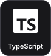</a>
  <a href="https://www.python.org/">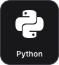</a>
  <a href="https://learn.microsoft.com/en-us/dotnet/csharp/">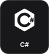</a>
  
  
  <a href="https://developer.mozilla.org/en-US/docs/Web/CSS">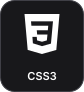</a>

### Frontend & Mobile

  <a href="https://react.dev/">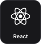</a>
  <a href="https://nextjs.org/">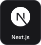</a>
  <a href="https://angular.dev/">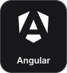</a>
  
  <a href="https://getbootstrap.com/">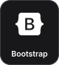</a>
  
  <a href="https://gsap.com/">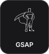</a>
  <a href="https://reactnative.dev/">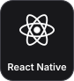</a>
  <a href="https://flutter.dev/">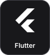</a>

### Backend

  <a href="https://nodejs.org/">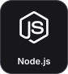</a>
  
  <a href="https://fastapi.tiangolo.com/">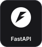</a>
  
  

### AI & Intelligent Tools

  <a href="https://openai.com/">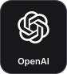</a>
  <a href="https://www.anthropic.com/claude">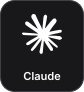</a>
  
  
  <a href="https://openai.com/codex/">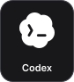</a>

**AI Expertise:** OpenAI API integration · AI-powered applications · Intelligent workflows and agents · AI-assisted development · Business automation

### Databases & ORM

  
  
  <a href="https://firebase.google.com/">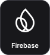</a>
  <a href="https://www.prisma.io/">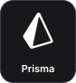</a>

### CMS, E-Commerce & Deployment

  
  
  <a href="https://vercel.com/">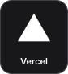</a>
  
  
  

### Tools & Version Control

  <a href="https://git-scm.com/">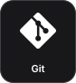</a>
  
  <a href="https://www.npmjs.com/">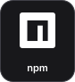</a>

---

## 💡 Core Expertise

| Area | Technologies |
|---|---|
| Frontend Engineering | React.js, Next.js, Angular, TypeScript, Tailwind CSS |
| Backend Engineering | Node.js, Express.js, Python, PHP, .NET |
| API Architecture | REST APIs, integrations, microservices |
| AI Integration | OpenAI API, custom AI agents, automation |
| Database Architecture | MongoDB, MySQL, Firebase, Prisma ORM |
| Cloud & Hosting | Vercel, Railway, Render, cPanel |

---

## 💼 Professional Experience

### Web Developer Intern — FortDice
**Mar 2026 – Present · Karachi, Pakistan**
- Developing and maintaining modern web applications and business platforms.
- Building responsive frontend interfaces and reusable components.
- Contributing to enterprise software and business management solutions.
- Working with APIs, integrations, and modern JavaScript technologies.

### Web Developer — TriTechTitan
**Nov 2025 – Feb 2026 · Karachi, Pakistan**
- Developed and maintained responsive web application features.
- Worked on frontend development and UI improvements.
- Integrated application components with backend functionality.
- Focused on clean code, usability, and maintainability.

---

## 🎓 Education

- **Advanced Diploma in Software Engineering (ADSE)** — Aptech Pakistan · 2024–2027
- **Intermediate in Computer Science (ICS)** — GDC Ghazi Goth, Karachi · 2025–2027

---

## 📊 GitHub Analytics

 

---

## 🤝 Let's Connect

### Building meaningful digital experiences through technology.

© 2026 Abdul Rafay. All rights reserved.

