<<<<<<< HEAD
<!-- ======================================================
     ABDUL RAFAY | GITHUB PROFILE README
     Icons live in ./assets (local SVG, no external icon CDN)
     ====================================================== -->

  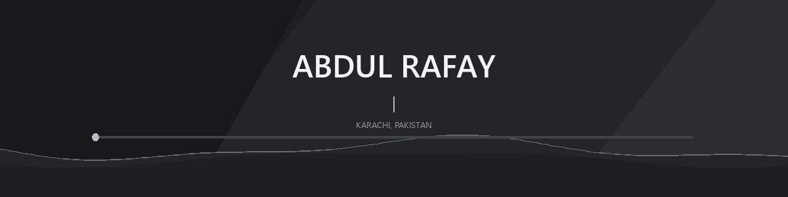

  <h1>Hi there, I'm Abdul Rafay</h1>

  <h3>Full-Stack MERN &amp; AI Developer</h3>

  

    Building scalable web applications, intelligent digital products,
    and modern software solutions.
  

  

  
  
  
  
  
  
  

  
&nbsp;Karachi, Pakistan

---

<h2>&nbsp;About Me</h2>

I'm **Abdul Rafay**, a Full-Stack MERN & AI Developer focused on building scalable, intelligent, and production-ready web applications.

I specialize in modern frontend development, backend engineering, database architecture, REST API development, AI integration, and application deployment. My development experience includes business platforms, enterprise management systems, SaaS applications, e-commerce solutions, and AI-powered web applications.

I enjoy solving real-world problems through clean code, thoughtful architecture, modern technologies, and user-focused development.

<h3>&nbsp;Professional Overview</h3>

- **Role:** Full-Stack MERN & AI Developer
- **Track Record:** 45+ Projects Delivered
- **Experience:** 1+ Year of Professional Experience
- **Core Focus:** Frontend & Backend App Development, REST APIs, AI Automation, Database Design, and Cloud Deployment
- **Availability:** Open for Freelance and Remote Opportunities

---

<h2>&nbsp;Technical Skills</h2>

*Click on any technology to visit its official website.*

### Programming Languages

  <a href="https://developer.mozilla.org/en-US/docs/Web/JavaScript" target="_blank">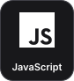</a>&nbsp;
  <a href="https://www.typescriptlang.org/" target="_blank">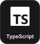</a>&nbsp;
  <a href="https://www.python.org/" target="_blank">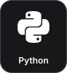</a>&nbsp;
  <a href="https://learn.microsoft.com/en-us/dotnet/csharp/" target="_blank">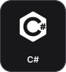</a>&nbsp;
  &nbsp;
  &nbsp;
  <a href="https://developer.mozilla.org/en-US/docs/Web/CSS" target="_blank">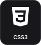</a>

### Frontend Development

  <a href="https://react.dev/" target="_blank">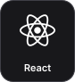</a>&nbsp;
  <a href="https://nextjs.org/" target="_blank">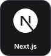</a>&nbsp;
  <a href="https://angular.dev/" target="_blank">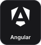</a>&nbsp;
  <a href="https://tailwindcss.com/" target="_blank">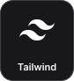</a>&nbsp;
  <a href="https://getbootstrap.com/" target="_blank">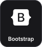</a>&nbsp;
  &nbsp;
  <a href="https://gsap.com/" target="_blank">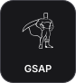</a>&nbsp;
  <a href="https://reactnative.dev/" target="_blank">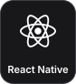</a>&nbsp;
  <a href="https://flutter.dev/" target="_blank">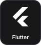</a>

### Backend Development

  <a href="https://nodejs.org/" target="_blank">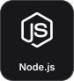</a>&nbsp;
  &nbsp;
  <a href="https://nestjs.com/" target="_blank">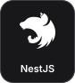</a>&nbsp;
  <a href="https://fastapi.tiangolo.com/" target="_blank">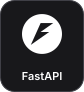</a>&nbsp;
  <a href="https://flask.palletsprojects.com/" target="_blank">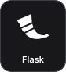</a>&nbsp;
  

### AI & Intelligent Tools

  <a href="https://openai.com/" target="_blank">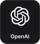</a>&nbsp;
  <a href="https://www.anthropic.com/claude" target="_blank">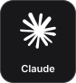</a>&nbsp;
  &nbsp;
  &nbsp;
  <a href="https://openai.com/codex/" target="_blank">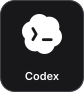</a>

  <strong>AI Expertise:</strong> OpenAI API Integration • AI-Powered Web Apps • Intelligent Workflows & Agents • AI-Assisted Development • Business Process Automation

### Databases & ORM

  &nbsp;
  &nbsp;
  <a href="https://firebase.google.com/" target="_blank">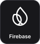</a>&nbsp;
  <a href="https://www.prisma.io/" target="_blank">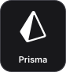</a>

### CMS, E-Commerce & Deployment

  &nbsp;
  &nbsp;
  <a href="https://vercel.com/" target="_blank">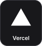</a>&nbsp;
  &nbsp;
  &nbsp;
  <a href="https://www.digitalocean.com/" target="_blank">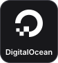</a>&nbsp;
  

### Tools & Version Control

  <a href="https://git-scm.com/" target="_blank">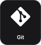</a>&nbsp;
  &nbsp;
  <a href="https://www.npmjs.com/" target="_blank">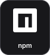</a>

---

<h2>&nbsp;Core Expertise</h2>

| Capability Area | Applied Technologies |
| :--- | :--- |
| **Frontend Engineering** | React.js, Next.js, AngularJS, TypeScript, Tailwind CSS |
| **Backend Engineering** | Node.js, Express.js, NestJS, Python, PHP, .NET |
| **API Architecture** | REST APIs, Backend Integrations, Microservices |
| **AI Integration** | OpenAI API, Custom AI Agents, Automation Scripts |
| **Database Architecture** | MongoDB, MySQL, Firebase, Prisma ORM |
| **Cloud & Hosting** | Vercel, Railway, Render, DigitalOcean, cPanel |

---

<h2>&nbsp;Selected Work</h2>

| Project | What it is | Stack | Live |
| :--- | :--- | :--- | :--- |
| **FortDice ERP Portal** | HR, attendance, payroll, accounting and CRM in one portal, with a companion Android app | React, TypeScript, Node.js, Express, MySQL, Socket.IO | [erp.fortdice.com](https://erp.fortdice.com/) |
| **FortFiler** | Tax filing and business services platform for Pakistan | React, Vite | [fortfiler.fortdice.com](https://fortfiler.fortdice.com/) |
| **FlipMyFile** | Free online PDF and file conversion tools, no sign-up | React, Vite, Tailwind CSS | [flipmyfile.space](https://flipmyfile.space/) |
| **Rainbow Flora UAE** | Floral e-commerce storefront for a Dubai rose supplier | React, Vite | [rainbowflorauae.com](https://rainbowflorauae.com/) |

More projects: [abdulrafay.runs-on.dev/projects](https://abdulrafay.runs-on.dev/projects)

---

<h2>&nbsp;Professional Experience</h2>

### Web Developer Intern — FortDice
**Mar 2026 – Present | Karachi, Pakistan**
- Developing and maintaining modern web applications and business platforms.
- Building responsive frontend interfaces and reusable application components.
- Contributing to enterprise software and business management solutions.
- Working with APIs, integrations, and modern JavaScript technologies.

### Web Developer — TriTechTitan
**Nov 2025 – Feb 2026 | Karachi, Pakistan**
- Developed and maintained responsive web application features.
- Worked on frontend development and user interface improvements.
- Integrated application components with backend functionality.
- Focused on clean code, usability, and maintainable development.

---

<h2>&nbsp;Education</h2>

- **Advanced Diploma in Software Engineering (ADSE)** | Aptech Pakistan *(2024 – 2027)*
- **Intermediate in Computer Science (ICS)** | GDC Ghazi Goth, Karachi *(2025 – 2027)*

---

<h2>&nbsp;GitHub Analytics</h2>

  
  
    
  

---

<h2>&nbsp;Let's Connect</h2>

  
  
  
  
  
  

  
<strong>Building meaningful digital experiences through technology.</strong>

  © 2026 Abdul Rafay. All rights reserved.

=======
<!-- ======================================================
     ABDUL RAFAY | GITHUB PROFILE README
     ====================================================== -->

  

  <h1>Hi there, I'm Abdul Rafay 👋</h1>

  <h3>Full-Stack MERN & AI Developer</h3>

  

    Building scalable web applications, intelligent digital products,
    and modern software solutions.
  

  

    <a href="https://abdulrafay.runs-on.dev" target="_blank">Portfolio</a>
    &nbsp; | &nbsp;
    <a href="https://github.com/Abdul-Rafay-21" target="_blank">GitHub</a>
    &nbsp; | &nbsp;
    <a href="https://www.linkedin.com/in/abdulrafaydeveloper" target="_blank">LinkedIn</a>
    &nbsp; | &nbsp;
    <a href="mailto:rafy123459@gmail.com">Email</a>
  

  
📍 Karachi, Pakistan

---

## 👨‍💻 About Me

I'm **Abdul Rafay**, a Full-Stack MERN & AI Developer focused on building scalable, intelligent, and production-ready web applications.

I specialize in modern frontend development, backend engineering, database architecture, REST API development, AI integration, and application deployment. My development experience includes business platforms, enterprise management systems, SaaS applications, e-commerce solutions, and AI-powered web applications. 

I enjoy solving real-world problems through clean code, thoughtful architecture, modern technologies, and user-focused development.

### 💼 Professional Overview

- **Role:** Full-Stack MERN & AI Developer
- **Track Record:** 45+ Projects Delivered
- **Experience:** 1+ Year of Professional Experience
- **Core Focus:** Frontend & Backend App Development, REST APIs, AI Automation, Database Design, and Cloud Deployment
- **Availability:** Open for Freelance and Remote Opportunities

---

## 🛠️ Technical Skills

*Click on any technology logo below to visit its official website.*

### Programming Languages

  &nbsp;&nbsp;
  &nbsp;&nbsp;
  &nbsp;&nbsp;
  &nbsp;&nbsp;
  &nbsp;&nbsp;
  &nbsp;&nbsp;
  &nbsp;&nbsp;
  

### Frontend Development

  &nbsp;&nbsp;
  &nbsp;&nbsp;
  &nbsp;&nbsp;
  &nbsp;&nbsp;
  &nbsp;&nbsp;
  &nbsp;&nbsp;
  &nbsp;&nbsp;
  &nbsp;&nbsp;
  

### Backend Development

  &nbsp;&nbsp;
  &nbsp;&nbsp;
  &nbsp;&nbsp;
  &nbsp;&nbsp;
  &nbsp;&nbsp;
  

### AI & Intelligent Tools

  &nbsp;&nbsp;
  &nbsp;&nbsp;
  &nbsp;&nbsp;
  

  <strong>AI Expertise:</strong> OpenAI API Integration • AI-Powered Web Apps • Intelligent Workflows & Agents • AI-Assisted Development • Business Process Automation

### Databases & ORM

  &nbsp;&nbsp;
  &nbsp;&nbsp;
  

### CMS, E-Commerce & Deployment

  &nbsp;&nbsp;
  &nbsp;&nbsp;
  &nbsp;&nbsp;
  &nbsp;&nbsp;
  &nbsp;&nbsp;
  

### Tools & Version Control

  &nbsp;&nbsp;
  &nbsp;&nbsp;
  &nbsp;&nbsp;
  

---

## 📈 Core Expertise

| Capability Area | Applied Technologies |
| :--- | :--- |
| **Frontend Engineering** | React.js, Next.js, AngularJS, TypeScript, Tailwind CSS |
| **Backend Engineering** | Node.js, Express.js, NestJS, Python, PHP, .NET |
| **API Architecture** | REST APIs, Backend Integrations, Microservices |
| **AI Integration** | OpenAI API, Custom AI Agents, Automation Scripts |
| **Database Architecture** | MongoDB, MySQL, Firebase, Prisma ORM |
| **Cloud & Hosting** | Vercel, Railway, Render, DigitalOcean, cPanel |

---

## 💼 Professional Experience

### Web Developer Intern — FortDice
**Mar 2026 – Present | Karachi, Pakistan**
- Developing and maintaining modern web applications and business platforms.
- Building responsive frontend interfaces and reusable application components.
- Contributing to enterprise software and business management solutions.
- Working with APIs, integrations, and modern JavaScript technologies.

### Web Developer — TriTechTitan
**Nov 2025 – Feb 2026 | Karachi, Pakistan**
- Developed and maintained responsive web application features.
- Worked on frontend development and user interface improvements.
- Integrated application components with backend functionality.
- Focused on clean code, usability, and maintainable development.

---

## 🎓 Education

- **Advanced Diploma in Software Engineering (ADSE)** | Aptech Pakistan *(2024 – 2027)*
- **Intermediate in Computer Science (ICS)** | GDC Ghazi Goth, Karachi *(2025 – 2027)*

---

## 📊 GitHub Analytics

  
  
    
  

---

## 📫 Let's Connect

  
  
  
  
  

  
<strong>Building meaningful digital experiences through technology.</strong>

  © 2026 Abdul Rafay. All rights reserved.

>>>>>>> 956bcac0724afb463d1de2a8a200febc258f0e61
